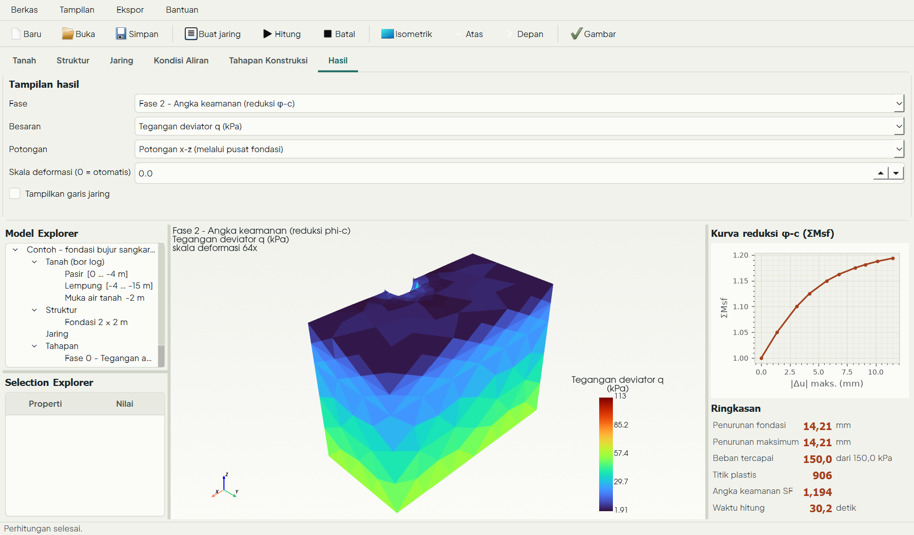

# GeoFEM 3D

[](https://github.com/geosr-lab/geofem3d/actions/workflows/uji.yml)

Program desktop sederhana untuk **analisis elemen hingga geoteknik 3D** yang ditulis dengan Python.
Kasus yang ditangani: fondasi persegi panjang (fleksibel atau kaku) di permukaan tanah berlapis
horizontal, dengan model tanah Mohr-Coulomb atau Hardening Soil (terdrainase) dan muka air tanah.



## 1. Instalasi

Dibutuhkan Python 3.10 atau lebih baru (diuji dengan 3.12 di Windows 11).

```bash
cd app
python -m venv .venv
.venv\Scripts\activate            # Linux/macOS: source .venv/bin/activate
pip install -r requirements.txt
```

Paket yang dipakai: NumPy, SciPy (matriks sparse), gmsh (jaring), PySide6 (antarmuka),
PyVista + pyvistaqt (tampilan 3D), Matplotlib (kurva), pytest (uji).

## 2. Cara pemakaian

```bash
python main.py                    # buka program
python main.py contoh.json        # buka proyek tersimpan
python -m pytest -q tests         # jalankan uji verifikasi
```

Alur kerja mengikuti tab di bagian atas jendela:

| Tab | Isi |
|---|---|
| **Tanah** | Tabel bor log: nama, model (Mohr-Coulomb / Hardening Soil), elevasi puncak/dasar, γunsat, γsat, E, ν, c, φ, ψ, dan parameter Hardening Soil (E50ref, Eoedref, Eurref, m, pref, νur, Rf) untuk setiap lapisan. Lebar domain x dan y, serta opsi simetri seperempat. |
| **Struktur** | Fondasi persegi panjang B × L, beban merata q (kPa), jenis fleksibel atau kaku. |
| **Jaring** | Ukuran elemen global, ukuran elemen halus di bawah fondasi, ukuran zona halus. Tombol **Buat jaring**. |
| **Kondisi Aliran** | Elevasi muka air tanah dan berat isi air γw. |
| **Tahapan Konstruksi** | Daftar fase (K0, beban plastis, reduksi φ-c), metode iterasi, toleransi, jumlah langkah. Tombol **Hitung** / **Batal** dan log perhitungan. |
| **Hasil** | Pilih fase dan besaran: perpindahan total, perpindahan vertikal, tegangan vertikal efektif/total, titik plastis. Skala deformasi bisa diatur. |

Di kiri ada **Model Explorer** (pohon objek: lapisan, muka air, fondasi, jaring, fase) dan
**Selection Explorer** (properti objek yang dipilih). Di tengah ada viewport 3D. Di kanan ada
**kurva beban-penurunan** dan **ringkasan** (penurunan fondasi, penurunan maksimum, beban
tercapai, jumlah titik plastis, angka keamanan SF).

Proyek disimpan sebagai JSON melalui menu **Berkas → Simpan / Buka**.

Opsi tambahan: `--screenshot gambar.png` (simpan gambar jendela lalu keluar) dan
`--self-test hasil.json` (jalankan alur kerja otomatis lalu keluar).

## 3. Teori singkat

**Satuan:** kN, m, kPa. Sumbu z ke atas; tarik bernilai positif.

**Elemen:** tetrahedron kuadratik 10 titik nodal, integrasi Gauss 4 titik. Jaring dibuat gmsh
(satu volume per lapisan, potongan di muka air tanah, persegi fondasi dicetak di permukaan,
medan ukuran *Box* untuk penghalusan di bawah fondasi).

**Tumpuan:** dasar dijepit penuh, sisi vertikal dijepit arah normal (rol). Dengan opsi simetri
hanya seperempat domain yang dihitung (x ≥ 0, y ≥ 0); hasil dicerminkan untuk tampilan.

**Fase 0 - tegangan awal (prosedur K0):**
σ'v = Σ γ·h − u, dengan γunsat di atas dan γsat di bawah muka air tanah, u = γw (z_w − z);
σ'h = K0 σ'v dengan **K0 = 1 − sin φ** (Jaky). Perpindahan fase ini nol.

**Fase 1 - beban fondasi plastis:** kontrol beban, inkremental-iteratif.
Setiap iterasi: regangan → tegangan coba elastis → *return mapping* Mohr-Coulomb di ruang
tegangan utama (bidang, tepi, atau puncak/apex; plastisitas sempurna, non-asosiatif dengan ψ).
Residu = F_ext − ∫Bᵀσ dV, konvergen bila ‖residu‖/‖ΔF_fondasi‖ ≤ toleransi (bawaan 0,01).
*Newton termodifikasi* memakai kekakuan elastis yang difaktorkan sekali (cepat, stabil);
*Newton penuh* memakai tangen konsisten numerik (lebih sedikit iterasi tetapi jauh lebih lambat).
Langkah beban otomatis diperbesar/diperkecil; bila langkah < 0,001 tanpa konvergensi, tanah
dinyatakan **runtuh**.

Fungsi leleh: f = (σ1 − σ3) + (σ1 + σ3) sin φ − 2 c cos φ.

**Fondasi kaku:** semua titik nodal di bawah fondasi diberi penurunan vertikal yang sama (satu
derajat kebebasan induk) dan tidak bergeser horizontal (kasar).

**Fase 2 - angka keamanan (reduksi φ-c):** tan φ dan c dibagi ΣMsf, ψ dibatasi ≤ φ tereduksi.
ΣMsf dinaikkan (awal 0,1) sampai keseimbangan tidak tercapai; kenaikan dibagi dua setiap gagal
hingga < 0,005. **SF = ΣMsf terakhir yang masih seimbang.**

**Hardening Soil (pengerasan geser)** mengikuti Schanz, Vermeer & Bonnier (1999):
kekakuan bergantung tegangan E50 = E50ref·((c cos φ + σ'3 sin φ)/(c cos φ + pref sin φ))^m, Eur sama
dengan Eurref; permukaan leleh hiperbolik f = (2/Ei)·q/(1 − q/qa) − 2q/Eur − γp dengan
Ei = 2E50/(2 − Rf), qa = qf/Rf, qf dari garis Mohr-Coulomb. γp adalah parameter pengerasan;
pada fase K0 nilainya diatur agar tegangan awal tepat di permukaan leleh. Elastisitas memakai
Eur(σ'3) dan νur. Bila q mencapai qf berlaku plastisitas sempurna Mohr-Coulomb. Pada fase reduksi
φ-c lapisan Hardening Soil dihitung sebagai Mohr-Coulomb dengan kekakuan Eur terakhir.
Uji triaksial satu titik (`tests/test_hardening_soil.py`) memastikan modulus sekan pada 50 % qf
sama dengan E50 dan kekuatan puncak sama dengan qf.

## 4. Batasan

- Hanya analisis terdrainase (tanpa tekanan pori ekses, tanpa konsolidasi atau aliran).
- Hardening Soil baru bagian pengerasan geser; **cap (pengerasan volumetrik) belum ada**, sehingga
  Eoedref belum dipakai dan kompresi satu dimensi primer terlalu kaku. Belum ada *tension cut-off*,
  HS-small, maupun dilatansi Rowe (ψ dibuat konstan).
- Lapisan tanah horizontal dan satu fondasi persegi panjang di permukaan, di tengah domain.
- Fondasi tidak dimodelkan sebagai elemen struktur (pelat/beton); hanya beban permukaan.
- Prosedur K0 hanya benar untuk permukaan tanah horizontal.
- Solver langsung (SuperLU) membatasi ukuran jaring praktis ± 50 000 derajat kebebasan.
- Hasil tergantung jaring: periksa dengan memperhalus jaring sampai hasil stabil.

## 5. Validasi terhadap perangkat lunak lain

Uji otomatis (`python -m pytest -q tests`) memeriksa:
1. **Patch test elastis** – medan perpindahan linear direproduksi tepat, tegangan konstan.
2. **Lapisan elastis dibebani merata** – penurunan = q·H / E_oed, E_oed = E(1−ν)/((1+ν)(1−2ν)).
3. **Satu elemen Mohr-Coulomb** – titik leleh tepat di permukaan leleh dan memenuhi
   σ1 = σ3·Nφ + 2c√Nφ (uji triaksial).

Untuk membandingkan dengan program lain (komersial maupun *open source*):
1. Buat model yang **sama persis**: geometri, lapisan, parameter, muka air, fondasi, tumpuan,
   fase (K0 → beban plastis → reduksi φ-c), dan toleransi 0,01.
2. Jalankan GeoFEM 3D tanpa GUI dan simpan hasilnya:
   ```bash
   python -m geofem.validation run proyek.json hasil_geofem.json
   ```
3. Ambil hasil program pembanding hanya melalui **antarmuka/skrip resmi** program tersebut
   (misalnya fitur *remote scripting* yang disediakan vendor) dan tulis ke `referensi.json`:
   ```json
   {"footing_settlement_mm": 14.0, "SF": 1.20, "curve": [[50, 4.1], [100, 9.0], [150, 14.0]]}
   ```
4. Bandingkan:
   ```bash
   python -m geofem.validation compare hasil_geofem.json referensi.json --tol 0.10
   ```
   Program mencetak selisih relatif tiap besaran dan status OK/BEDA.

Hal yang wajar menimbulkan perbedaan: jenis dan kerapatan elemen, cara menerapkan fondasi kaku,
definisi titik kontrol penurunan, perlakuan puncak (apex) Mohr-Coulomb, *tension cut-off*,
kriteria konvergensi, dan aturan pengurangan ψ pada reduksi φ-c. Selisih 5–15 % untuk penurunan
dan ± 0,05 untuk SF umumnya dapat diterima; selisih lebih besar perlu dicek dengan memperhalus
jaring di kedua program.

### Validasi otomatis terhadap PLAXIS 3D (API resmi)

`validasi/bandingkan_plaxis.py` menghitung proyek dengan GeoFEM 3D, lalu membangun dan menghitung
model yang sama di PLAXIS 3D lewat **Python Remote Scripting** resmi (`validasi/plaxis_run.py`,
dijalankan dengan Python bawaan PLAXIS), kemudian menulis tabel perbandingan CSV dan Markdown.
Program PLAXIS tidak dibongkar; hanya perintah scripting yang didokumentasikan vendor yang dipakai.

1. Buka PLAXIS 3D Input, pilih **Expert → Configure remote scripting server**, aktifkan server
   (port Input bawaan 10000, Output 10001) dan buat kata sandi sendiri.
2. Di PowerShell, isi variabel lingkungan (kata sandi tidak pernah disimpan di berkas):
   ```powershell
   $env:PLAXIS_PASSWORD = "kata-sandi-anda"
   $env:PLAXIS_INPUT_PORT = "10000"; $env:PLAXIS_OUTPUT_PORT = "10001"
   ```
3. Jalankan:
   ```powershell
   .venv\Scripts\python.exe validasi\bandingkan_plaxis.py contoh\pondasi_pasir_lempung.json --keluar hasil_validasi
   ```
4. Hasil: `hasil_validasi/perbandingan.md` dan `.csv` (penurunan pusat fondasi, penurunan maksimum,
   SF, selisih %).

Catatan: model PLAXIS dibuat penuh (tanpa simetri) dengan jaring relatif 0,05. Nama properti
material PLAXIS ada di `PROP_MC` / `PROP_HS` dalam `plaxis_run.py`; bila PLAXIS versi Anda menolak
salah satu nama, sesuaikan di sana.

## 6. Sumber teori

- Schanz, T., Vermeer, P.A., Bonnier, P.G. (1999). *The hardening soil model: formulation and
  verification*. Beyond 2000 in Computational Geotechnics, Balkema.
- de Souza Neto, E.A., Perić, D., Owen, D.R.J. (2008). *Computational Methods for Plasticity*. Wiley.
- Jâky, J. (1944). The coefficient of earth pressure at rest.
- Griffiths, D.V., Lane, P.A. (1999). Slope stability analysis by finite elements. *Géotechnique* 49(3).
- Manual PLAXIS 3D (Material Models, Scientific) yang terpasang bersama PLAXIS dipakai hanya sebagai
  bacaan teori; tidak ada teks, gambar, atau kode PLAXIS yang disalin ke proyek ini.

## 7. Tampilan dan aset

Tampilan diselaraskan dengan situs [GeoSR](https://geosr-lab.github.io/): warna token GeoSR (tema
terang dan gelap, menu **Tampilan → Tema**), huruf Archivo dan Plus Jakarta Sans. Kedua huruf
berlisensi SIL Open Font License 1.1; berkas TTF di `geofem/aset/font/` dikonversi dari WOFF2
Fontsource tanpa mengubah glyph, lisensinya disertakan di folder yang sama.

## 8. Versi browser (GeoSR)

`geofem/web.py` dan `geofem/mesh_terstruktur.py` membuat GeoFEM 3D bisa dijalankan di browser lewat
Pyodide (WebAssembly), tanpa gmsh dan tanpa GUI. Halamannya ada di
[geosr-lab.github.io/geofem3d](https://geosr-lab.github.io/geofem3d/); berkas solver di situs itu
disalin dari folder `geofem/` repo ini. Jaringnya terstruktur (garis grid di tepi pondasi, batas
lapisan, dan muka air tanah). Contoh bawaan: jaring kasar 13,90 mm dan SF 1,29, jaring sedang
14,49 mm dan SF 1,16, jaring gmsh desktop 14,21 mm dan SF 1,19.

## 9. Lisensi

Kode GeoFEM 3D berlisensi [MIT](LICENSE), sama seperti GeoSR. Huruf di `geofem/aset/font/`
tetap berlisensi SIL Open Font License 1.1 (berkas lisensinya ada di folder itu).
